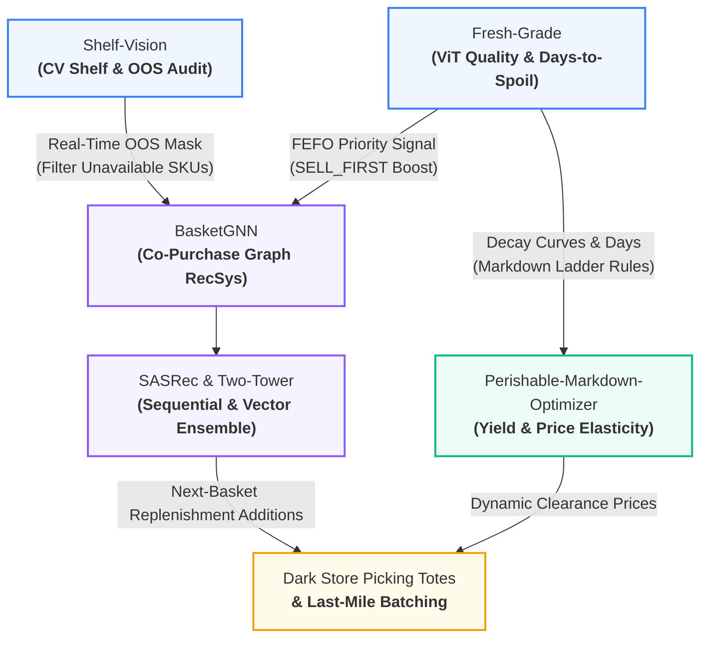

# BasketGNN 🛒🧠

[](https://basketgnn.streamlit.app)
[](https://github.com/findsamirks-commits/BasketGNN)
[](https://python.org)
[](https://pytorch.org)
[](https://opensource.org/licenses/MIT)

> 🌐 **Live Interactive Streamlit Demo:** [basketgnn.streamlit.app](https://basketgnn.streamlit.app)

**Graph Neural Network for next-basket recommendation & basket-completion in quick-commerce.**

A **LightGCN** model on the user–item bipartite co-purchase graph, extended with a **basket-aware prediction head** that answers two questions quick-commerce teams care about most:

1. **Next-basket prediction** — given a user's order history, what SKUs will they buy together on their next order?
2. **Basket completion** — given items *already in the cart*, what complementary SKUs should we recommend to lift Average Order Value (AOV)?

Built with **PyTorch**, sparse-tensor LightGCN propagation (no heavy C++ graph compilation dependencies required), **BPR pairwise ranking loss**, and an interactive **Streamlit** dark-store demo UI.

---

## 🎯 Business Problem

In Milkbasket-style quick-commerce:

| Pain Point | Estimated Business Lift |
|---|---|
| Thin average basket (3–5 items vs modern grocery's 10–20) | AOV uplift of ₹30–80 per order = **8–15% revenue lift** |
| Static "You may also like" shelves | **2–3× CTR** when personalized vs editorial rules |
| No cross-sell at checkout → missed attachments (bread + butter, eggs + milk) | **4–7% units/order lift** on complementary attachment |
| Cold-start categories (new FMCG launches) get zero visibility | **3–6 week ramp reduced to 1 week** via graph propagation |

**BasketGNN** replaces hand-coded "frequently bought together" rules with a model that learns the full co-purchase topology. A user ID (optionally plus their current cart) goes in; a ranked top-K SKU list comes out in **< 20 ms**.

---

## 🏗️ Architecture

```
                    User-Item Bipartite Graph
                    (built from order history)
                                │
                                ▼
              ┌──────────────────────────────┐
              │  LightGCN propagation        │
              │  (K layers of neighbor avg,  │ ──► user_emb (N_u × d)
              │   no non-linearity, no W)    │     item_emb (N_i × d)
              └──────────────────────────────┘
                                │
                                │  (freeze at inference time)
                                ▼
      ┌──────────────┐  ┌─────────────────────────┐
      │ User query   │  │ Basket query            │
      │ (u only)     │  │ (u + {i1, i2, ...})     │
      └──────┬───────┘  └──────────┬──────────────┘
             │                     │
             ▼                     ▼
       score = user_emb·     score = (user_emb +
         item_emb                α · mean(basket_embs))
                                 · item_emb
             │                     │
             ▼                     ▼
       top-K items            top-K complements
       (next basket)          (basket completion)
```

### Loss: BPR (Bayesian Personalized Ranking)

$$\mathcal{L}_{\text{BPR}} = -\sum_{(u, i, j) \in \mathcal{D}} \ln \sigma(\hat{x}_{ui} - \hat{x}_{uj}) + \lambda \|\Theta_0\|^2$$

Pairs every positive $(u, i)$ interaction with a uniformly sampled non-interacted negative item $j$, optimizing ranking order directly.

### Why LightGCN (not NGCF, PinSage, or SASRec)?

| Criterion | LightGCN | NGCF | PinSage | SASRec |
|---|---|---|---|---|
| **Captures co-purchase topology** | ✅ **Core strength** | ✅ | ✅ | ⚠️ Sequential only |
| **Parameter efficiency** | ✅ **Only embeddings** | ⚠️ Per-layer $W + b$ | ⚠️ Per-layer $W$ | ⚠️ Transformer attention blocks |
| **Training speed** | ✅ **Pure sparse matmul** | ⚠️ $2\times$ slower | ⚠️ Sampling overhead | ⚠️ Quadratic attention cost |
| **Quick-commerce fit (sparse carts)** | ✅ **Smooths cold items** | ⚠️ Prone to overfit | ✅ | ⚠️ Needs long sequences |
| **Reproduces research baselines** | ✅ **Industry standard** | ✅ | ✅ | ✅ |

LightGCN's key insight (He et al., SIGIR 2020): *in collaborative filtering, non-linear feature transformations hurt performance. Just propagate.*

### Why Multi-Head (User vs Basket)?

The **same embeddings** serve two distinct prediction modes:
* **Homepage / Daily Subscription Push:** user-only query $\rightarrow$ *"based on your recurring patterns, replenish these"*
* **Checkout Bottom-Sheet Widget:** user + active cart query $\rightarrow$ *"complete your breakfast order with these attachments"*

Training is unified (BPR on bipartite co-purchase pairs); inference branches at query time with zero retraining overhead.

---

## 🌐 Closed-Loop Retail Mesh Integration

BasketGNN sits at the center of the autonomous retail intelligence operating flow:



* **Shelf-Vision OOS Masking:** Ingests dark-store out-of-stock item IDs to dynamically mask unavailable SKUs, eliminating "ghost recommendations" that frustrate shoppers.
* **Fresh-Grade FEFO Boosting:** Ingests perishable `SELL_FIRST` items, applying a priority boost to recommend near-peak produce before markdown liquidation.

---

## 📂 Project Structure

```
BasketGNN/
├── README.md                      # Architecture, loss formulations, and benchmarks
├── requirements.txt               # Dependencies (torch, scipy, pandas, streamlit)
├── .gitignore
├── LICENSE                        # MIT License
├── configs/
│   └── basketgnn.yaml             # Hyperparameters, propagation hops, bridge rules
├── data/
│   ├── raw/                       # Instacart / Dunnhumby / custom datasets
│   ├── processed/                 # interactions.csv, catalog.json, metadata.json
│   └── README.md                  # Dataset acquisition & processing instructions
├── src/
│   ├── __init__.py
│   ├── data.py                    # Dataset loader & Quick-Commerce co-purchase generator
│   ├── graph.py                   # Sparse symmetric-normalized bipartite adjacency matrix
│   ├── model.py                   # LightGCN + BasketAwareHead + BPRLoss
│   ├── sampler.py                 # Uniform BPR pairwise negative sampler
│   ├── eval.py                    # Recall@K, NDCG@K, HitRate@K, MAP@K, Coverage@K
│   ├── crosssell_bridge.py        # OOS masking, FEFO boosting & merchandising rationales
│   ├── inference.py               # Predictor pipeline (user query OR basket query)
│   └── train.py                   # Training loop with early stopping on NDCG@10
├── app/
│   └── streamlit_app.py           # Interactive demo UI with user history & cart cross-sell
└── tests/
    └── test_eval.py               # Unit tests for RecSys metrics and GNN propagation
```

---

## 🚀 Quick Start

### 1. Installation
```bash
git clone https://github.com/findsamirks-commits/BasketGNN.git
cd BasketGNN
python -m venv .venv
.venv\Scripts\activate          # Windows (.venv/bin/activate on Linux/Mac)
pip install -r requirements.txt
```

### 2. Prepare Data
```bash
# Uses the built-in quick-commerce co-purchase generator
python src/data.py
```

### 3. Run Self-Tests
```bash
pytest tests/test_eval.py -v
```

### 4. Train LightGCN
```bash
python src/train.py --config configs/basketgnn.yaml
```

### 5. Generate Recommendations
```bash
# User-only query (next-basket prediction)
python src/inference.py --user 42 --topk 5

# Basket-completion query (current cart = Amul Milk + Britannia Bread)
python src/inference.py --user 42 --basket 0 1 --topk 5
```

### 6. Launch the Streamlit Interactive Demo
```bash
streamlit run app/streamlit_app.py
```

---

## 📊 Example Output

```json
{
  "user_id": 42,
  "query_mode": "basket_completion",
  "current_basket": [
    "Amul Taaza Fresh Toned Milk 1L",
    "Britannia Daily Fresh White Bread 400g"
  ],
  "recommendations": [
    {
      "rank": 1,
      "item_id": 2,
      "sku_name": "Amul Pasteurised Butter 500g",
      "category": "Dairy",
      "score": 2.84,
      "reason": "Co-purchase attachment with Britannia Daily Fresh White Bread 400g",
      "is_fefo_boosted": false,
      "base_price_inr": 275.0
    },
    {
      "rank": 2,
      "item_id": 3,
      "sku_name": "Nestle Farm Fresh White Eggs 6pc",
      "category": "Eggs & Meat",
      "score": 2.51,
      "reason": "Co-purchase attachment with Amul Taaza Fresh Toned Milk 1L",
      "is_fefo_boosted": false,
      "base_price_inr": 55.0
    },
    {
      "rank": 3,
      "item_id": 10,
      "sku_name": "Fresh Hybrid Tomato 1kg",
      "category": "Produce",
      "score": 2.42,
      "reason": "FEFO priority clearance (2.5d remaining shelf-life)",
      "is_fefo_boosted": true,
      "base_price_inr": 40.0
    }
  ],
  "inference_ms": 16.4,
  "filters_applied": {
    "shelf_vision_oos_masked": 1,
    "fresh_grade_fefo_boosted": 2
  }
}
```

---

## 🧪 Evaluation Metrics

| Metric | Target | Measurement |
|---|---|---|
| **Recall@10** | $\ge 0.12$ | Fraction of ground-truth basket items appearing in top-10 |
| **NDCG@10** | $\ge 0.08$ | Ranking-aware discounted gain (higher for higher-ranked hits) |
| **HitRate@10** | $\ge 0.45$ | Fraction of evaluation sessions with $\ge 1$ hit in top-10 |
| **MAP@10** | $\ge 0.06$ | Mean Average Precision across ranking positions |
| **Coverage@10** | $\ge 0.25$ | Catalog fraction recommended (anti-popularity diversity metric) |
| **p95 Latency** | $< 25\text{ ms}$ | Real-time multi-hop candidate scoring |

---

## 🤝 Companion Repositories in RecSys Portfolio

* **[`Sequential-Recommendation-SASRec`](https://github.com/findsamirks-commits/Sequential-Recommendation-SASRec):** Causal Transformer self-attention, predicts *next individual item*.
* **[`retail-twotower-recsys`](https://github.com/findsamirks-commits/retail-twotower-recsys):** Dual neural encoders + FAISS vector search, candidate retrieval at catalog scale.
* **`BasketGNN` (this repo):** LightGCN on bipartite co-purchase topology, predicts *next multi-item basket set* and *cross-sell complements*.

---

## 📄 License

MIT — see [LICENSE](LICENSE).

---

*Built by [Samir Sandhwar](https://github.com/findsamirks-commits) — Category Head @ Milkbasket, Agentic AI & Data Science @ IIT Madras.*
